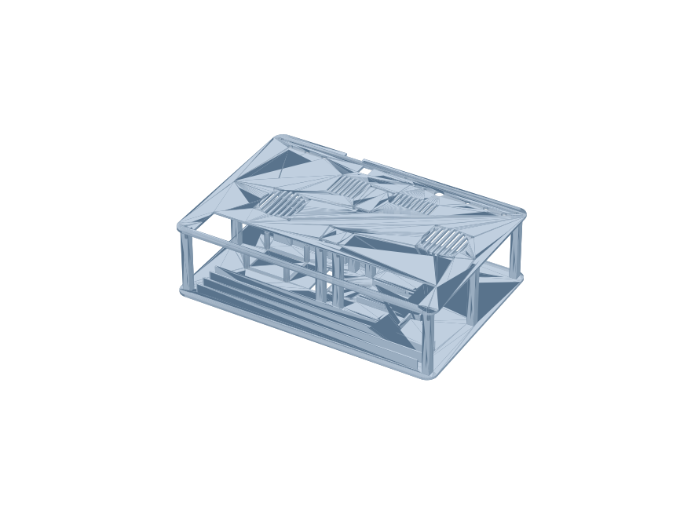
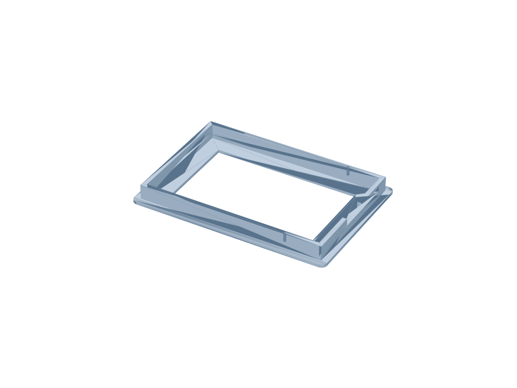
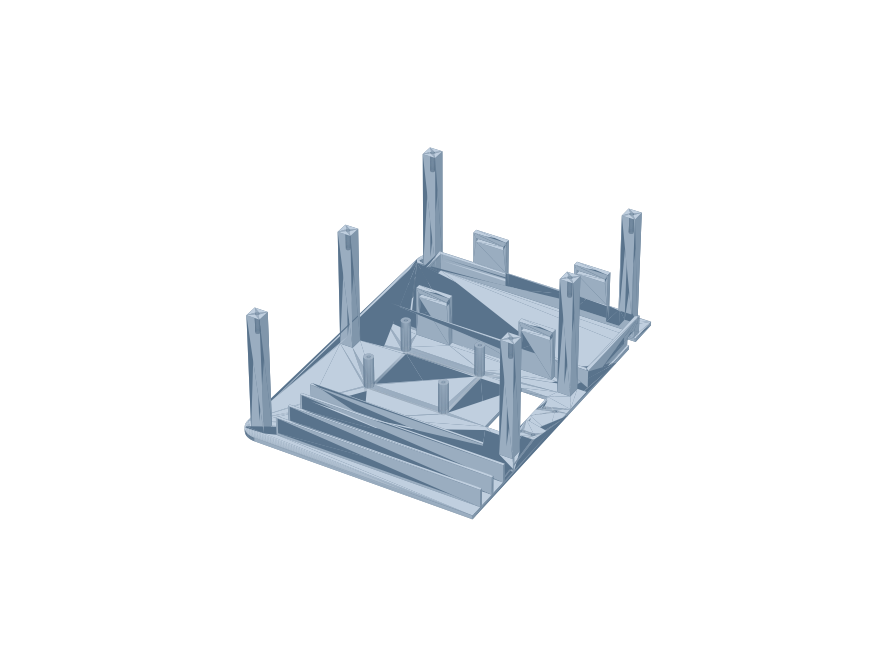
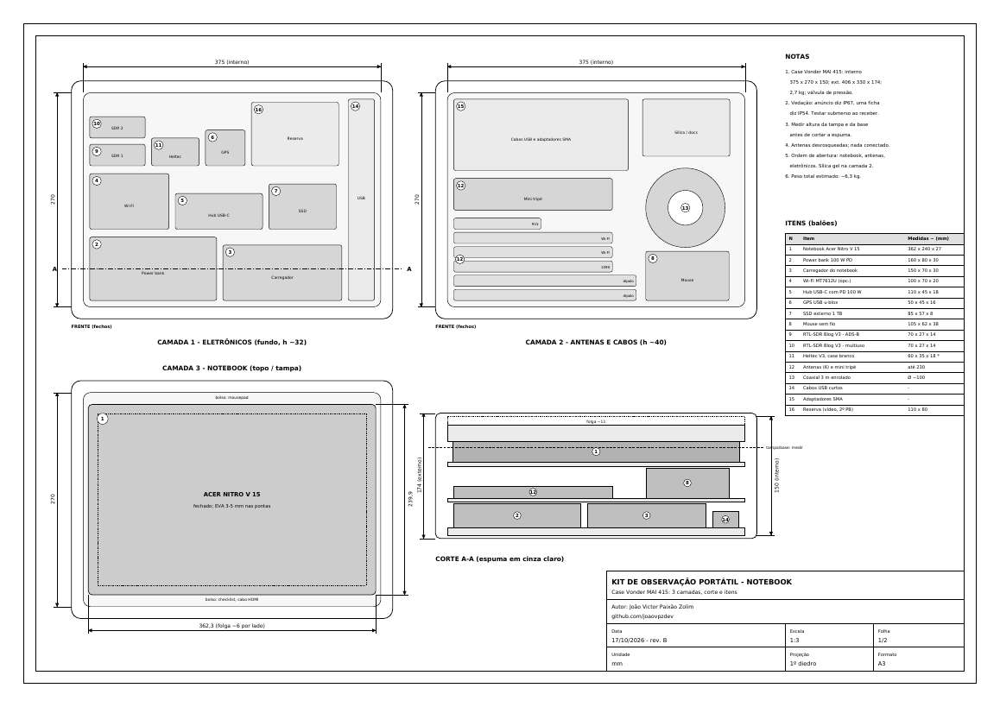

<div align="center">

```text
 ██████╗██╗   ██╗██████╗ ███████╗██████╗ ██████╗ ███████╗ ██████╗██╗  ██╗
██╔════╝╚██╗ ██╔╝██╔══██╗██╔════╝██╔══██╗██╔══██╗██╔════╝██╔════╝██║ ██╔╝
██║      ╚████╔╝ ██████╔╝█████╗  ██████╔╝██║  ██║█████╗  ██║     █████╔╝
██║       ╚██╔╝  ██╔══██╗██╔══╝  ██╔══██╗██║  ██║██╔══╝  ██║     ██╔═██╗
╚██████╗   ██║   ██████╔╝███████╗██║  ██║██████╔╝███████╗╚██████╗██║  ██╗
 ╚═════╝   ╚═╝   ╚═════╝ ╚══════╝╚═╝  ╚═╝╚═════╝ ╚══════╝ ╚═════╝╚═╝  ╚═╝
            [ how to cyberdeck & stuff ]  ::  SAR FIELD TERMINAL
```


**Um terminal de campo dentro de uma mala rígida: rede mesh sem internet, GPS, tela touch, rádio SDR e bateria para horas — feito para busca e salvamento (SAR).**

</div>

```console
chakal@field:~$ cat /etc/motd
> Sem torre. Sem internet. Sem desculpa.
> Este repositório ensina a montar, peça por peça, um cyberdeck SAR em duas edições
> o kit portátil de observação com notebook e o homelab que recebe tudo o que eles coletam.
```

---

## `> ls ./índice`

```text
[00] whoami ........................ o que é este projeto
[01] edicoes ....................... completo x R$ 5 mil
[02] tree .......................... estrutura do repositório
[03] bom ........................... lista de materiais
[04] build ......................... montagem, componente por componente
[05] boot .......................... software
[06] selftest ...................... validação na bancada
[07] field-ops ..................... operação em campo e clima hostil
[08] rules ......................... regras, licenças e segurança
[09] regen ......................... como gerar PDFs e STLs de novo
[10] homelab ....................... base fixa: 4 ThinkCentre Tiny no rack 10"
[11] kit ........................... estação de escuta portátil com o notebook
[12] roadmap ....................... próximos decks
```

---

## `[00] > whoami`

O **Cyberdeck SAR** é uma estação de campo autônoma para operações de busca e salvamento. Ele resolve três problemas que aparecem em toda ocorrência longe da cidade:

| Problema no campo | O que o deck faz |
|---|---|
| Sem sinal de celular | Rede **mesh LoRa (Meshtastic)**: mensagens e posições entre equipe, base e drones, sem torre |
| "Onde está cada equipe?" | **GPS** em cada nó e **mapa offline** na tela de 7" |
| Registro da operação | Tudo fica gravado com hora certa; sincroniza com o homelab quando houver internet |

Conceito físico:

```text
          TAMPA (aberta)                       BASE
   ┌─────────────────────────┐     ┌─────────────────────────────┐
   │  ┌───────────────────┐  │     │ [FAN in]  painel 3D  [FAN out]│
   │  │   TOUCH 7"  (VHB) │  │     │  SMA SMA SMA  RJ45  USB-C  SW │
   │  └───────────────────┘  │     ├─────────────────────────────┤
   │                         │     │ UPS + Pi 5 + HAT LoRa/GPS     │
   └─────────────────────────┘     │ berços USB   power bank       │
                                   └─────────────────────────────┘
   fechado = IP67, nenhum furo  ·  aberto = ar circulando, operação
```

---

## `[01] > ./edicoes --compare`

| | 🟥 **Completo** (`cyberdeck-sar-completo/`) | 🟩 **R$ 5 mil** (`cyberdeck-sar-5k/`) |
|---|---|---|
| Case | Pelican 1450, IP67 *(ou Vonder MAI 415)* | Patola MP-0039, IP67 |
| Computador | Raspberry Pi 5 **16 GB** + SSD NVMe | Raspberry Pi 5 **8 GB** + microSD High Endurance |
| Rádio principal | HAT RAK6421 + LoRa 1 W (RAK13302) + GPS (RAK12501) | igual |
| Extras | RTL-SDR Blog V3, Wi-Fi MT7612U, modem 4G, 2º LoRa | berços prontos, compra depois |
| Energia | UPS X1202 + power bank 20.000 mAh | UPS X1202 (power bank opcional) |
| Autonomia | ~5 h com tudo ligado | ~3,5 h (UPS) / ~9 h (com power bank) |
| Custo | **~R$ 9.500** | **R$ 5.000** (R$ 4.725 + reserva) |
| Peças 3D | 7 modelos | 9 modelos (+ calços para o case maior) |

> 💡 As duas edições usam **o mesmo modelo 3D paramétrico**. Mudar de case é mudar um número (`DECK_Z`) e gerar os STL de novo.

---

## `[02] > tree -L 2`

```text
howtocyberdeckandstuff/
├── README.md                      ← você está aqui
├── docs/img/                      ← renders e folhas usados nos READMEs
├── cyberdeck-sar-completo/
│   ├── README.md                  ← resumo técnico da edição
│   ├── cyberdeck_sar_pelican1450_desenho_tecnico.pdf   (A3, 4 folhas)
│   ├── documento/                 ← conceito, montagem e aplicações (PDF)
│   ├── modelo3d/stl/              ← peças prontas para fatiar
│   ├── modelo3d/cyberdeck_3d.py   ← fonte paramétrica das peças
│   └── gerar_pdf.py               ← gera o desenho técnico
├── cyberdeck-sar-5k/
│   ├── README.md
│   ├── cyberdeck_sar_5k_desenho_tecnico.pdf            (A3, 4 folhas)
│   ├── documento/                 ← análise de custos e evolução (PDF)
│   ├── modelo3d/stl/              ← peças + calços
│   └── gerar_pdf.py
├── homelab-thinkcentre-tiny/
│   ├── README.md                  ← rack, serviços, VLANs, fases
│   ├── homelab_rack_desenho_tecnico.pdf                (A3, rev. D, 3 folhas)
│   ├── plano/                     ← plano de monitoramento e observação (PDF)
│   ├── guia/                      ← Kiwix offline + estação de satélite (PDF)
│   ├── fase5-ia/                  ← nó de IA, rack de GPU 5 placas, guia EPYC
│   └── gerar_desenho.py
└── kit-portatil-nitro/
    ├── README.md                  ← o que opera, cenários de uso, rastro de RF
    ├── kit_observacao_notebook_desenho_tecnico.pdf     (A3, rev. B, 2 folhas)
    ├── docker-compose.yml         ← adsb, sonde, ism, mosquitto, kiwix, central
    ├── .env.example
    └── gerar_desenho.py
```

<div align="center">


</div>

---

## `[03] > cat bom.csv`

### Núcleo (as duas edições)

| Componente | Função | Observação |
|---|---|---|
| Raspberry Pi 5 (8 ou 16 GB) | Cérebro: mapas, Meshtastic, registros | Dissipador **baixo** (o HAT vai por cima) |
| HAT RAK6421 (WisMesh) | Liga o rádio LoRa e o GPS ao Pi | Barra de pinos **estendida** |
| RAK13302 (LoRa SX1262, 1 W, 915 MHz) | Rádio da rede mesh | Confira o limite de potência na Anatel |
| RAK12501 (GPS) | Posição e hora | Antena ativa externa |
| Geekworm UPS X1202 + 4 × 18650 | Nobreak interno (5,1 V / 5 A) | Baterias protegidas, de marca |
| Raspberry Pi Touch Display 2 (7") | Tela na tampa | Cabo DSI |
| 2 ventoinhas 60 mm 5 V | Fluxo de ar | 25 mm (completo) ou 15 mm (R$ 5 mil) |
| Conectores de painel | SMA, keystone RJ45, USB-C, chave | Tudo no painel impresso, nada no case |
| Filamento ASA ou PETG (~1 kg) | Bandeja, painel, moldura | **Não use PLA** (deforma no sol) |

### Extras da edição completa

| Componente | Função |
|---|---|
| SSD NVMe + gaveta USB | Logs, mapas grandes, gravações |
| RTL-SDR Blog V3 | ADS-B (aviões) e análise de espectro — o V4 saiu de linha |
| Adaptador Wi-Fi MT7612U | Modo monitor (auditoria autorizada) — substitui o Alfa ACM |
| Modem 4G USB | Link com a base quando houver cobertura |
| Power bank 20.000 mAh pass-through | Recarga sem abrir o deck |

Preços detalhados e fases de compra: veja os PDFs de cada edição.

---

## `[04] > ./build --verbose`

> ⚠️ **Antes de tudo:** leia a seção *"Antes de imprimir"* do README de cada edição e confira as medidas com as peças em mãos. Os modelos usam medidas de catálogo.

### `[04.1]` Impressão 3D

```console
$ ls modelo3d/stl/
01_bandeja_esquerda.stl  02_bandeja_direita.stl  03_painel_esquerdo.stl
04_painel_direito.stl    05_moldura_tela.stl     06_travessa_tela_x2.stl
07_tala_emenda_x4.stl    (5k: + 08_calco_* e 09_calco_*)
```

| Parâmetro | Valor |
|---|---|
| Material | **ASA** (melhor contra sol e calor) ou PETG |
| Bico / camada | 0,4 mm / 0,2 mm |
| Perímetros / preenchimento | 4 / 25% giroide |
| Mesa mínima | 256 × 256 mm (por isso bandeja e painel vêm em metades) |
| Furos M3 | Ø 3,2 mm (autoatarraxante) ou Ø 4,2 mm (inserto de latão) |

1. Imprima as metades com os **pilares para cima**; a moldura com a **janela para baixo**.
2. Una as metades da bandeja e do painel com as **talas** e parafusos M3.
3. Teste o encaixe no case vazio antes de montar qualquer eletrônico.

### `[04.2]` Case

- **Nenhum furo.** Toda conexão sai pelo painel impresso, com a tampa aberta. Fechado, o case mantém a vedação.
- **Completo:** Pelican 1450 (interno 372 × 260 × 155 mm). Alternativa: **Vonder MAI 415** (406 × 330 × 174 externo, 375 × 270 × 150 interno, ~R$ 400) — confirme a altura da base e faça o teste da água.
- **R$ 5 mil:** Patola MP-0039 (interno 390 × 315 × 135 mm). O chassi é o mesmo; os **calços** impressos travam a bandeja no case maior e o painel desce para 80 mm (`DECK_Z = 80`).
- Teste de vedação ao receber: papel-toalha dentro, case fechado, 10 min debaixo d'água. Saiu seco? Aprovado.

### `[04.3]` Energia: UPS X1202 + baterias

```text
USB-C do painel ──► power bank (pass-through) ──► UPS X1202 ──► Pi 5 (5,1 V / 5 A)
```

1. Instale as 4 células 18650 na X1202 **respeitando a polaridade**.
2. Fixe a X1202 nos standoffs da bandeja (padrão de furação do Pi 5, 58 × 49 mm).
3. Confira se as baterias ficam livres do piso (standoffs de 24 mm).
4. Na edição completa, prenda o power bank no compartimento com duas cintas de velcro de 20 mm.
5. Ligue: USB-C do painel → entrada do power bank; saída do power bank → entrada da UPS.

> 🔋 Se o power bank cortar a saída por um instante ao trocar de fonte, a UPS segura o Pi. É para isso que ela existe.

### `[04.4]` Raspberry Pi 5

1. Grave o **Raspberry Pi OS Lite 64 bits** (ou Desktop, se for usar a tela com interface) no microSD/SSD.
2. Coloque o **dissipador baixo**: a ventoinha oficial não cabe sob o HAT.
3. Monte o Pi sobre a UPS (pilha: UPS → Pi → HAT).
4. Na edição completa, ligue o SSD na gaveta USB 3.0 (porta azul).

### `[04.5]` HAT RAK6421 + LoRa + GPS

1. Encaixe o RAK13302 (LoRa) e o RAK12501 (GPS) nos slots do HAT.
2. Use **barra de pinos estendida** para o HAT ficar acima do dissipador.
3. **Nunca ligue o rádio LoRa sem antena** — transmitir sem carga danifica o rádio.
4. Ligue os pigtails U.FL → SMA até o painel.

### `[04.6]` Antenas e painel

```text
painel (vista de cima)
┌──────────────────────────────────────────────┐
│ ( FAN in )   SMA:LoRa  SMA:GPS  [SMA x4 ext]  │
│              RJ45   USB-C   SW    ( FAN out ) │
└──────────────────────────────────────────────┘
```

1. Instale os conectores SMA de painel (completo: 6; R$ 5 mil: 2, os outros furos ficam para as expansões).
2. Instale o keystone RJ45, o USB-C de painel e a chave das ventoinhas.
3. As antenas são **desrosqueadas e guardadas no porta-antenas** antes de fechar o case.

### `[04.7]` Ventilação

- Ventoinha de **entrada** sobre o Pi (com **filtro de espuma** contra poeira) e de **saída** do lado oposto.
- O ar cruza a bandeja: entra pelo painel, passa pela pilha UPS/Pi/HAT e sai pelo outro lado.
- Liga e desliga pela chave do painel. Monitore: `vcgencmd measure_temp` (o Pi reduz o clock perto de 85 °C).

### `[04.8]` Tela na tampa

1. Fixe a **moldura impressa** na tampa com **fita VHB 3M** (sem furar).
2. Encaixe a Touch Display 2 e trave com as duas **travessas**.
3. Passe o cabo DSI pela dobradiça com folga para a tampa abrir e fechar sem esticar.

<div align="center"></div>

### `[04.9]` Dongles USB (berços)

| Berço | Dispositivo | Dica |
|---|---|---|
| SDR | RTL-SDR Blog V3 | Grave um serial: `rtl_eeprom -s ADSB` |
| Wi-Fi | MT7612U | Confira o chip: `lsusb` deve mostrar `0e8d:7612` |
| 4G | Modem USB | Prefira modelo homologado pela Anatel |
| SSD | Gaveta NVMe | Porta USB 3.0 |

Prenda tudo com **abraçadeiras** passando pelos rasgos do piso.

### `[04.10]` Fechamento

1. Ligue os cabos (pigtails SMA, extensões USB curtas, DSI).
2. Parafuse o painel nos 12 pilares.
3. Coloque a bandeja no case, a **sílica gel** no canto e feche.

---

## `[05] > ./boot.sh`

```console
# 1. Base
sudo apt update && sudo apt full-upgrade -y
sudo raspi-config            # SSH com chave, fuso, hostname

# 2. Rede privada até o homelab
curl -fsSL https://tailscale.com/install.sh | sh
sudo tailscale up

# 3. Mesh
#   Instale o meshtasticd pelo guia oficial do Meshtastic para Raspberry Pi
#   e ative a configuração do RAK6421 que vem em /etc/meshtasticd/available.d/
#   (o nome exato do arquivo muda entre versões: confira antes de copiar).

# 4. Observabilidade
sudo apt install -y suricata zabbix-agent2
```

| Serviço | Para quê |
|---|---|
| `meshtasticd` | Nó Meshtastic rodando no próprio Pi |
| Mapas offline | Tiles da região baixados antes da missão |
| Tailscale | Acesso ao homelab de qualquer lugar, sem abrir porta |
| Suricata | Sensor de rede pela porta RJ45 |
| Zabbix agent | Temperatura, bateria e saúde do deck no painel do homelab |

---

## `[06] > ./selftest`

```text
[ ] Ligado na bancada, sem case, por 1 h: temperatura do Pi abaixo de ~80 °C
[ ] meshtasticd vê o rádio; outro nó recebe mensagem e posição
[ ] GPS fixa posição a céu aberto
[ ] Tela e toque funcionando com a tampa fechando sem esticar o cabo
[ ] Tirar a tomada: a UPS segura o Pi sem reiniciar
[ ] Recarga pelo USB-C do painel com o deck ligado
[ ] Teste de vedação do case vazio aprovado
```

---

## `[07] > ./field-ops`

| Momento | Procedimento |
|---|---|
| Antes de sair | Carga cheia, mapas da região atualizados, antenas e sílica gel no case |
| Instalação | Ponto alto, céu aberto, tampa aberta, antenas rosqueadas **antes** de ligar |
| Durante | Tampa aberta para ventilar; sob chuva, opere abrigado (aberto, o deck não é vedado) |
| Encerramento | Desligar, desrosquear antenas, guardar, fechar, exportar o relatório |

Clima hostil:

- **Fechado:** IP67. **Aberto:** só sob abrigo.
- Verniz conformal nas placas contra umidade e maresia.
- Baterias de lítio só carregam entre **0 e 45 °C**.

---

## `[08] > cat RULES.md`

> 🛑 **Leia antes de transmitir qualquer coisa.**

- **LoRa 915 MHz:** faixa de radiação restrita. Confira na **Anatel** o limite de potência e de ganho de antena antes de usar o rádio em 1 W. Prefira equipamento homologado.
- **SDR e ADS-B:** só recepção.
- **Wi-Fi em modo monitor e porta RJ45:** **somente em redes próprias ou com autorização por escrito.**
- **Drones:** cadastro no **SISANT (ANAC)** e autorização de voo no **SARPAS (DECEA)**.
- **LGPD:** posições de equipes e vítimas são dados pessoais. Canal Meshtastic privado com chave, nada em servidor MQTT público, descarte após o relatório.

---

## `[09] > ./regen`

Todos os PDFs e STLs são gerados por código. Mudou uma medida? Gere de novo.

```console
$ python3 -m venv .venv && source .venv/bin/activate
$ pip install manifold3d trimesh reportlab matplotlib

$ cd cyberdeck-sar-completo        # ou cyberdeck-sar-5k
$ python modelo3d/cyberdeck_3d.py  # STLs em modelo3d/stl/
$ python gerar_pdf.py              # desenho técnico A3
$ python documento/gerar_documento.py   # (5k: gerar_documento_5k.py)
```

Parâmetros principais (topo de `modelo3d/cyberdeck_3d.py`):

| Parâmetro | O que controla |
|---|---|
| `CASE_INT` | Medidas internas do case |
| `DECK_Z` | Altura do painel: **95** (Pelican / MAI 415) ou **80** (Patola MP-0039) |
| `PB_IN` | Compartimento do power bank |
| `PI_ORIGIN`, `FAN_IN`, `FAN_OUT` | Posição do Pi e das ventoinhas |

---

## `[10] > ssh homelab`

O deck vai para o campo; o **homelab** fica em casa. São 4 **Lenovo ThinkCentre M720q Tiny** num mini rack de 10" que monitoram a própria rede, observam o céu (ADS-B, satélites meteorológicos, radiossondas) e guardam o que o deck e o kit portátil trazem de volta.

```text
 ┌──────── RACK 10" · 8U ────────┐        campo                 casa
 │ U1  switch  VLAN 10/20/30     │   ┌──────────────┐  Tailscale  ┌──────────┐
 │ U2  nó 1   monitoramento      │   │ cyberdeck /  │ ──────────► │ nó 1     │
 │ U3  nó 2   dados + VM radio   │   │ kit portátil │   MQTT      │ Grafana  │
 │ U4  nó 3   lab isolado        │   └──────────────┘             │ InfluxDB │
 │ U5  nó 4   sensor de rede     │                                └──────────┘
 │ U6  base de encaixe do kit    │   em casa, os rádios do kit encaixam na U6
 │ U7-8 fontes · régua · nobreak │   e passam para a VM "radio" do nó 2
 └───────────────────────────────┘
```

| Peça | Conteúdo |
|---|---|
| [`homelab-thinkcentre-tiny/`](homelab-thinkcentre-tiny/) | README com hardware, serviços, VLANs, fases e ordem de montagem |
| Desenho técnico rev. D | Rack, rede/elétrica e antenas com a base de encaixe (3 folhas A3) |
| Plano de observação | Grafana, Security Onion, feeds (NASA FIRMS, INPE, USGS, Cemaden), ADS-B, sensores |
| Guia | Wikipédia offline (Kiwix) e recepção de satélites com SatDump |
| [`fase5-ia/`](homelab-thinkcentre-tiny/fase5-ia/) | IA local: nó 5 com GPU, rack de alumínio para 5 placas e host EPYC (desenhos + guia de 9 páginas) |

<div align="center"></div>

---

## `[11] > ./kit --portatil`

Entre o deck (campo) e o homelab (casa) existe o **kit portátil**: o notebook Acer Nitro V 15 com Linux, rádios USB e um `docker compose`, tudo numa **Vonder MAI 415** em 3 camadas. Em casa, os mesmos rádios encaixam no rack.

```text
 SDR 1  ── 1090 MHz ──► aviões no mapa (tar1090)
 SDR 2  ── 137 MHz  ──► satélites Meteor-M (SatDump)
        ── 400 MHz  ──► radiossondas (auto_rx)          um perfil por vez
        ── 433 MHz  ──► sensores ISM (rtl_433 → MQTT)
 Heltec ── 915 MHz  ──► mesh Meshtastic com o cyberdeck
 GPS    ──────────────► posição e hora sem internet
 SSD    ──────────────► Wikipédia e mapas offline (Kiwix)
```

| Peça | Conteúdo |
|---|---|
| [`kit-portatil-nitro/`](kit-portatil-nitro/) | README com cada equipamento e seu serviço, cenários de uso, o que transmite e o que só escuta, BOM e ordem de montagem |
| Desenho técnico rev. B | Camadas do case, corte, ligações USB/RF, energia e lista de materiais (2 folhas A3) |
| `docker-compose.yml` | Serviços prontos com perfis para trocar a função do SDR 2 |

Custo: **~R$ 2.635** no essencial (notebook já existente), ~R$ 3.265 com opcionais.

<div align="center"></div>

---

## `[12] > cat ROADMAP`

```text
[x] v1  Cyberdeck SAR completo (Pelican 1450 / Pi 5 16 GB)
[x] v1  Edição R$ 5 mil (Patola MP-0039 / Pi 5 8 GB)
[ ] v2  Deck ThinkPad T14 numa Vonder MAI 415: placa-mãe solta, tela 10,1" touch,
        pack 4S de células 21700 com USB-C PD
[x] lab Homelab ThinkCentre Tiny — documentação rev. D (rack, plano, guia)
[x] ia  Fase 5: nó de IA, rack de GPU 2020 e guia do host EPYC (documentação)
[ ] ia  Montagem: 1ª RTX 3060 no nó 5, depois host EPYC e placas G2-G5
[x] kit Kit de observação com notebook (Nitro V15) — documentação rev. B e compose
[ ] kit Montagem do kit: Heltec V3 comprado, demais itens em compra
[ ] hub Integração deck/kit → homelab (Grafana, MQTT, InfluxDB via Tailscale)
```

---

<div align="center">

```text
┌──────────────────────────────────────────────────────────────┐
│  built by João Victor Paixão Zolim  ·  github.com/joaovpzdev │
│  SAR · blue team · homelab · rádio                           │
└──────────────────────────────────────────────────────────────┘
```

`EOF`

</div>
