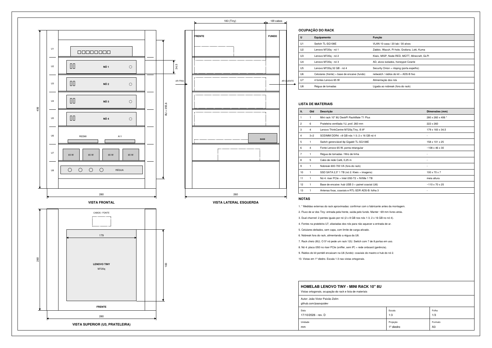
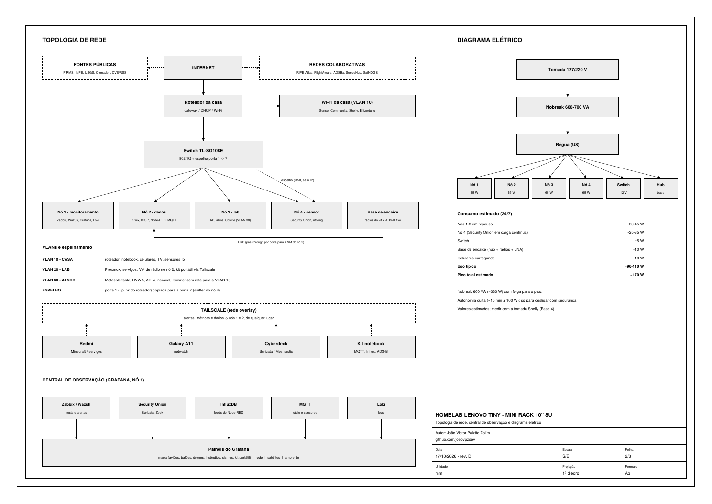

# `> ./homelab --tiny --rack 10"`

```text
 ┌─────────────── MINI RACK 10" · 8U ───────────────┐
 │ U1 ▓ switch TL-SG108E   VLAN 10/20/30 + espelho  │
 │ U2 ▓ M720q nó 1         monitoramento            │
 │ U3 ▓ M720q nó 2         dados + VM "radio"       │
 │ U4 ▓ M720q nó 3         lab / alvos isolados     │
 │ U5 ▓ M720q nó 4 32 GB   sensor (Security Onion)  │
 │ U6 ▒ celulares + base de encaixe do kit          │
 │ U7 ░ 4 fontes 65 W                               │
 │ U8 ░ régua → nobreak 600-700 VA                  │
 └──────────────────────────────────────────────────┘
```

Homelab com mini PCs **Lenovo ThinkCentre M720q Tiny** num mini rack de 10". Ele é a **base fixa** dos projetos deste repositório: monitora a própria rede, observa o céu e o mundo e recebe os dados do cyberdeck e do kit portátil quando eles voltam do campo.

---

## `$ ls`

| Arquivo | O que é |
|---|---|
| `homelab_rack_desenho_tecnico.pdf` | Desenho técnico A3, **rev. D**, 3 folhas: rack, rede/elétrica e antenas com a base de encaixe |
| `plano/homelab_plano_observacao.pdf` | Plano de monitoramento e observação global (10 páginas): fases, custos, instalação de cada serviço |
| `guia/homelab_satelite_biblioteca_offline.pdf` | Guia v1.0: Kiwix (Wikipédia offline) e estação de satélite (SatDump) |
| `gerar_desenho.py`, `plano/`, `guia/` | Scripts que geram os PDFs (ReportLab) |

<div align="center">

</div>

---

## `$ cat hardware.txt`

| Item | Qtd | Observação |
|---|---|---|
| Lenovo ThinkCentre M720q Tiny, i5 8ª geração | 4 | Nós 1–3 com 16 GB (2 × 8 GB); nó 4 com 32 GB (2 × 16 GB) |
| Mini rack 10" 8U DeskPi RackMate T1 Plus | 1 | 6 prateleiras ventiladas |
| Switch gerenciável TP-Link TL-SG108E | 1 | 802.1Q e espelhamento de porta |
| Nó 4: riser PCIe + Intel i350-T2 + NVMe 1 TB | 1 | Placa só para escutar o tráfego espelhado |
| SSD SATA 1 TB no nó 2 | 1 | Kiwix, livros e imagens de satélite |
| Nobreak 600–700 VA | 1 | Fora do rack |

---

## `$ cat services.yml`

```yaml
no1_monitoramento:   [zabbix, wazuh, pi-hole, grafana, influxdb, loki, uptime-kuma, crowdsec]
no2_dados:           [kiwix, calibre-web, misp, node-red, mosquitto, freshrss,
                      changedetection, ripe-atlas, minecraft, glpi, vm-radio]
no3_lab:             [active-directory, alvos-vlan30, cowrie-honeypot]
no4_sensor:          [security-onion, ntopng]
vm_radio:            [readsb, satdump, rtl_433, radiosonde_auto_rx, gpsd, kismet]
```

| VLAN | Uso |
|---|---|
| 10 – casa | roteador, notebook, celulares, TV, sensores IoT |
| 20 – lab | Proxmox, serviços, VM de rádio; kit portátil via Tailscale |
| 30 – alvos | laboratório vulnerável e honeypot, **sem rota para a VLAN 10** |
| espelho | porta 1 (uplink) copiada para a porta 7 (sniffer do nó 4) |

<div align="center">

</div>

---

## `$ ./fases --custo`

| Fase | O que entra | Custo (estim.) |
|---|---|---|
| 0 – Base | 3 nós M720q, rack, switch, memória, nobreak | ~R$ 5.000 (plano original) |
| 1 – Software | Grafana, InfluxDB, Loki, Uptime Kuma, CrowdSec, Node-RED com feeds (NASA FIRMS, INPE, USGS, Cemaden), RIPE Atlas, MISP, FreshRSS, Cowrie | **R$ 0** |
| 2 – Sensor de rede | Nó 4 com Security Onion + ntopng | ~R$ 2.520 |
| 3 – Antenas fixas e base de encaixe | ADS-B fixo, mastro com 5 antenas, painel coaxial, hub | ~R$ 2.610 |
| 4 – Ambiente | Sensor.Community, tomada Shelly, Blitzortung | ~R$ 400 + Blitzortung |

> 📡 Os rádios do **kit portátil** (2 RTL-SDR Blog V3, Heltec V3, GPS, Wi-Fi MT7612U, SSD) encaixam no rack quando você está em casa e vão no case quando você sai. Só o RTL-SDR do ADS-B fica sempre em casa.

---

## `$ ./build --order`

1. **Base:** monte o rack, instale o Proxmox nos nós, crie as VLANs no switch e nas bridges.
2. **Fase 1:** suba a central no Grafana. É software e já entrega valor no primeiro dia.
3. **Biblioteca offline:** siga o `guia/` (Kiwix num contêiner LXC do nó 2).
4. **Fase 2:** nó 4, espelhamento porta 1 → 7, Security Onion na VM (26 GB) e ntopng.
5. **Fase 3:** mastro aterrado, protetores de surto (DPS) em todos os coaxiais, painel coaxial e base de encaixe na U6.
6. **Fase 4:** sensores ambientais.

Passo a passo de cada serviço: `plano/homelab_plano_observacao.pdf`.

---

## `$ cat rules.md`

- Nenhuma porta aberta no roteador; acesso de fora **só pelo Tailscale**.
- O espelhamento enxerga o tráfego de todos na casa: avise quem mora com você e guarde o mínimo.
- Honeypot e alvos ficam na VLAN 30, sem rota para a rede da casa.
- ADS-B, satélites e radiossondas são só recepção; o único transmissor é o LoRa (915 MHz, radiação restrita).
- Mastro aterrado e DPS nos coaxiais. Em tempestade, solte os coaxiais do painel.

---

## `$ ./regen`

```console
$ pip install reportlab
$ python gerar_desenho.py            # desenho técnico (3 folhas)
$ cd plano && python gerar_plano.py  # plano de observação
$ cd ../guia && python gerar_guia.py # guia Kiwix + satélite
```

> Os scripts usam as fontes DejaVu (`/usr/share/fonts/truetype/dejavu/`), presentes na maioria das distribuições Linux.
