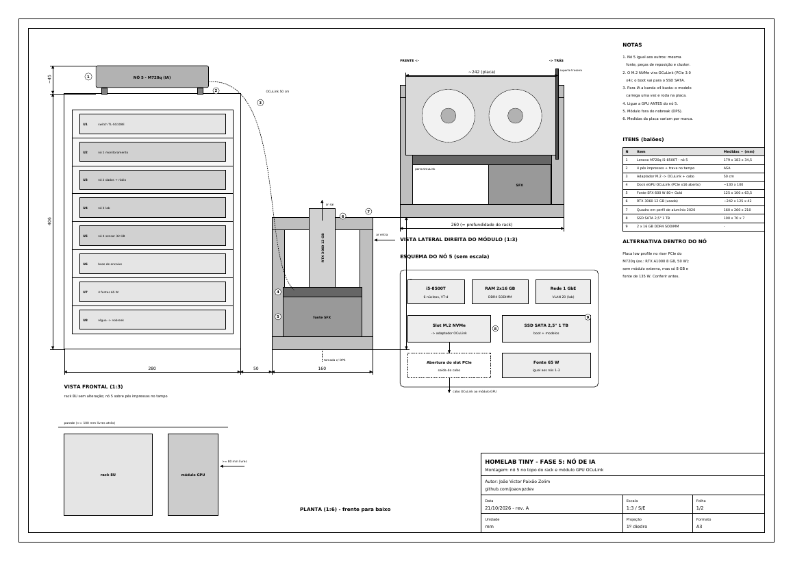
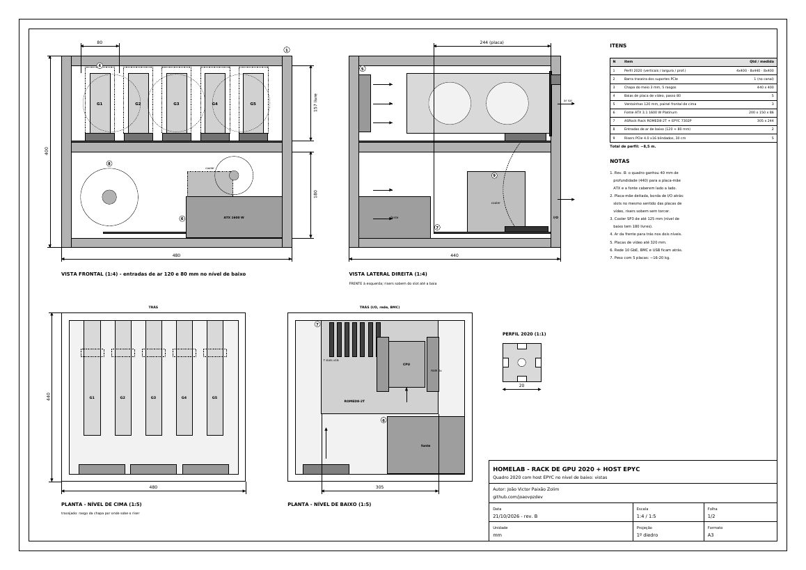

# `> ./fase5 --ia --local`

```text
 RACK 10" (Tiny)          RACK DE GPU 2020 (480 × 440 × 400)
 ┌──────────────┐         ┌──────────────────────────────────┐
 │ nó 5 (topo)  │─OCuLink─│  G1   G2   G3   G4   │   G5      │
 │ U1 ... U8    │(início) ├──────────────────────────────────┤
 └──────────────┘         │  host EPYC · ROMED8-2T · 1600 W  │
                          └──────────────────────────────────┘
   G1-G4: vLLM (modelo principal)   G5: Whisper + Ollama
```

Fase 5 do homelab: **IA rodando em casa**, para resumir alertas do Wazuh e do Security Onion, responder sobre os documentos do lab, transcrever áudio de rádio e escrever rascunhos de relatório SAR. Nada sai da rede de casa.

O projeto cresce em etapas: começa com **uma placa de vídeo ligada a um Tiny** e termina com **cinco placas num rack de alumínio comandado por um servidor EPYC**.

---

## `$ ls`

| Arquivo | O que é |
|---|---|
| `homelab_fase5_no_ia_desenho_tecnico.pdf` | Rev. A, 2 folhas: nó 5 (M720q) no topo do rack com uma RTX 3060 por OCuLink, serviços, energia e custos |
| `homelab_rack_gpu_5_placas_desenho_tecnico.pdf` | Rev. B, 2 folhas: rack em perfil 2020 para 5 placas com o host EPYC no nível de baixo |
| `guia/homelab_host_ia_epyc.pdf` | Guia de implementação (9 páginas): compra, montagem, BIOS, Proxmox, VM com 5 placas, vLLM, rede, monitoramento, liga/desliga e testes |
| `gerar_no5.py`, `gerar_rack_gpu.py`, `guia/` | Scripts que geram os PDFs (ReportLab) |

<div align="center">

</div>

---

## `$ ./upgrade --path`

| Etapa | Placas | Como ligam | Custo (estim.) |
|---|---|---|---|
| 1 | 1 × RTX 3060 12 GB | Nó 5 (M720q): M.2 → OCuLink → dock | ~R$ 4.660 |
| 2 | Rack de GPU pronto | O mesmo dock, agora na baia G1 do rack 2020 | + ~R$ 1.500 |
| 3 | Host EPYC | ROMED8-2T + EPYC 7302P + 128 GB; a placa vai do nó 5 para o slot | host + rack ~R$ 12.700 |
| 4 | Até 5 placas | Uma por baia, G2 a G5 (5 × 3060 = 60 GB de VRAM) | ~R$ 19.700 com 5 × 3060 |
| 5 | Troca por 3090 | 5 × 3090 = 120 GB de VRAM | ~R$ 25.000 só nas placas |

<div align="center">

</div>

---

## `$ cat host.yml`

```yaml
host-ia:          # 6º nó do Proxmox, desligado quando não está em uso
  placa_mae: ASRock Rack ROMED8-2T   # 7 x PCIe 4.0 x16, IPMI, 2 x 10 GbE
  cpu: AMD EPYC 7302P                # comprar SEM trava de fabricante (PSB)
  ram: 8 x 16 GB DDR4-3200 RDIMM ECC
  fonte: ATX 3.1 1600 W Platinum
vm_ia:            # Ubuntu 24.04 com as 5 placas por passthrough
  G1-G4: vllm (tensor parallel = 4)  # modelo principal
  G5:    [faster-whisper, ollama]    # transcrição, embeddings, modelos pequenos
  front: open-webui
```

5 placas não dividem bem um modelo; por isso **4 + 1**.

---

## `$ cat rules.md`

- Host, BMC e VM na **VLAN 20**; acesso de fora só pelo **Tailscale**. O BMC nunca fica exposto.
- Com mais de 3 placas: **tomada de 20 A exclusiva com DPS**, feita por eletricista; 5 × 3090 pedem circuito dedicado.
- Placas com limite de potência (`nvidia-smi -pl`) e host **desligado quando parado**: ligado e ocioso ele gasta ~140 W.
- Alertas, logs e documentos ficam em casa (**LGPD**).

---

## `$ ./regen`

```console
$ pip install reportlab
$ python gerar_no5.py                       # fase 5, nó 5 + OCuLink
$ python gerar_rack_gpu.py                  # rack de GPU + host EPYC
$ cd guia && python gerar_guia_host.py      # guia de implementação
```

> Preços estimados em out/2026; usados e importados variam muito.
