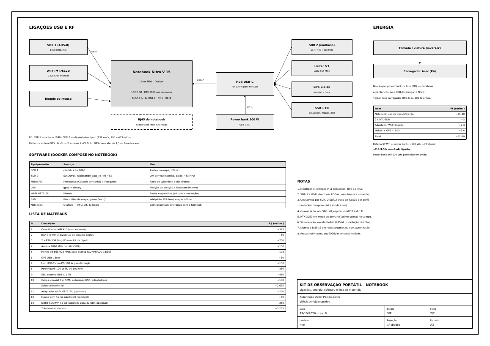

# `> ./kit --portatil --host nitro-v15`

```text
 ┌──────────── VONDER MAI 415 · 3 camadas ────────────┐
 │ TOPO     notebook Acer Nitro V 15 (fechado, EVA)   │
 │ MEIO     6 antenas · mini tripé · coaxial · cabos  │
 │ FUNDO    2× RTL-SDR · Heltec V3 · GPS · Wi-Fi ·    │
 │          hub USB-C PD · SSD · power bank · carreg. │
 └────────────────────────────────────────────────────┘
   abre a tampa → monta antenas → USB no notebook → docker compose up
```

Uma **estação de observação que cabe numa mala**: o notebook que você já tem, rádios USB baratos e um `docker compose`. Ela escuta aviões, satélites meteorológicos, balões de radiossonda e sensores de 433 MHz, conversa com a rede mesh do cyberdeck e leva a Wikipédia offline. Em casa, os mesmos rádios encaixam no **homelab** e continuam trabalhando.

> É um projeto **separado** do cyberdeck: o deck é o terminal SAR autônomo (Raspberry Pi); o kit é a estação de escuta montada em volta do notebook.

---

## `$ ls`

| Arquivo | O que é |
|---|---|
| `kit_observacao_notebook_desenho_tecnico.pdf` | Desenho técnico A3, **rev. B**, 2 folhas: camadas do case, corte, ligações, energia, software e lista de materiais |
| `docker-compose.yml` | Serviços do kit com perfis para o SDR 2 (`sonde`, `ism`) e a central (`central`) |
| `.env.example` | Posição da estação e caminho do SSD |
| `mosquitto/mosquitto.conf` | Broker MQTT local |
| `gerar_desenho.py` | Gera o PDF (ReportLab) |

<div align="center">

</div>

---

## `$ whatis kit`: o que dá para operar

| Equipamento | Escuta / faz | Software (Docker ou nativo) | Na prática |
|---|---|---|---|
| **RTL-SDR Blog V3 nº 1** + antena 1090 | ADS-B, 1090 MHz | `ultrafeeder` (readsb + tar1090) | Aviões e helicópteros no mapa, sem internet. Numa busca, mostra quem está sobrevoando a área |
| **RTL-SDR Blog V3 nº 2** + dipolo | 137 MHz | SatDump (nativo) | Imagens dos satélites **Meteor-M** (LRPT): nuvens e frentes frias de verdade, recebidas no campo |
| ↳ mesmo SDR, outro perfil | 400–406 MHz | `radiosonde_auto_rx` | Balões meteorológicos: posição, altitude, temperatura e vento em altitude; dá até para ir buscar o balão |
| ↳ mesmo SDR, outro perfil | 433,92 MHz | `rtl_433` → MQTT | Estações meteorológicas, sensores e controles ISM da vizinhança, decodificados em JSON |
| **Heltec V3** (LoRa 915 MHz) | Rede mesh | Meshtastic (CLI / serial) + Mosquitto | Nó da mesma rede do cyberdeck: mensagens e posições entre equipes, sem torre |
| **GPS u-blox** | Posição e hora | `gpsd` + `chrony` (nativo) | Coordenadas da estação e relógio certo sem internet: carimbo de hora confiável em tudo |
| **Wi-Fi MT7612U** | 2,4 / 5 GHz em modo monitor | Kismet (nativo) | Inventário de redes e aparelhos. **Só em redes próprias ou com autorização** |
| **SSD 1 TB** | Armazenamento | `kiwix-serve` | Wikipédia, WikiMed, manuais e mapas offline; gravações IQ dos satélites |
| **Notebook** | Central | Grafana + InfluxDB (`central`), Tailscale | Painéis locais e sincronização com o homelab quando houver internet |

Um serviço por rádio: o **SDR 1 é dedicado ao ADS-B**; o **SDR 2 troca de função** por perfil do compose. O serial gravado na EEPROM (`ADSB` / `MULTI`) faz cada serviço achar o rádio certo, em qualquer porta.

---

## `$ cat cenarios.md`: conceitos de uso

| Cenário | Como o kit entra |
|---|---|
| **Apoio a SAR com o cyberdeck** | O kit fica na base avançada: o Heltec entra na mesh, o MQTT recebe as posições das equipes, o ADS-B mostra aeronaves na área e a radiossonda/Meteor dão o tempo real para decidir se dá para voar o drone |
| **Estação meteorológica de campo** | Meteor-M na passagem da manhã, radiossonda do lançamento das 12Z, sensores 433 MHz: tudo no Grafana, com hora do GPS |
| **Viagem e acampamento offline** | Kiwix + mapas no SSD, GPS e mesh: biblioteca e comunicação sem sinal de celular |
| **Laboratório de rádio** | Gravação IQ no SSD para estudar sinais depois em casa, sem precisar estar lá na passagem |
| **Auditoria Wi-Fi autorizada** | Kismet com o MT7612U e a porta RJ45 do notebook, com autorização por escrito do dono da rede |
| **Em casa** | Os rádios encaixam na **base de encaixe** (U6) do homelab e passam para a VM `radio` do nó 2. Mesmos serviços, mesmos seriais |

### Do campo para o homelab

```text
  CAMPO (kit)                                  CASA (homelab rev. D)
  ┌─────────────────────┐   Tailscale / MQTT   ┌────────────────────────────┐
  │ Mosquitto + Influx  │ ───────────────────► │ nó 1: Grafana, InfluxDB    │
  │ gravações no SSD    │ ──── rsync na volta ►│ nó 2: SSD de 1 TB          │
  └─────────────────────┘                      └────────────────────────────┘
  ao voltar: hub USB-C sai do notebook e entra na base de encaixe (U6);
  o passthrough por porta USB entrega os mesmos rádios à VM "radio"
```

Só o SDR do ADS-B **fixo** (com LNA e bias-tee no mastro) mora no homelab; os rádios do kit vão e voltam. Detalhes no [`homelab-thinkcentre-tiny/`](../homelab-thinkcentre-tiny/).

---

## `$ ./opsec --rf`: o kit deixa rastro?

| Parte | Transmite? | Comentário |
|---|---|---|
| SDRs (ADS-B, satélite, sonda, 433) | **Não** | Recepção pura. Não há como detectar à distância quem está ouvindo |
| GPS | **Não** | Só recebe dos satélites |
| Kismet em modo monitor | **Não**, se ficar só ouvindo | Associar a redes, mandar *probes* ou *deauth* já é transmitir (e o deauth é ilegal sem autorização) |
| Heltec / Meshtastic | **Sim** | Transmite em 915 MHz e anuncia posição. Canal privado com chave e `position_precision` reduzida se a posição for sensível |
| Notebook com Wi-Fi/Bluetooth ligados | **Sim** | Sondas de Wi-Fi e anúncios Bluetooth. Desligue o que não usa |
| Tailscale / internet | **Sim** | Conexões cifradas, mas a operadora vê que existe tráfego |

Ouvir é passivo; transmitir é o que identifica a estação. Por isso a regra do kit é **só recepção, exceto a mesh**.

---

## `$ cat bom.csv`

| Item | R$ (estim.) |
|---|---|
| Case Vonder MAI 415 com espuma | ~397 |
| EVA 3–5 mm e divisórias extras | ~60 |
| 2 × RTL-SDR Blog V3 com kit de dipolo | ~700 |
| Antena 1090 MHz portátil (SMA) | ~150 |
| Heltec V3 863–928 MHz, case branco ✅ **comprado** | ~198 |
| GPS USB u-blox | ~80 |
| Hub USB-C com PD 100 W pass-through | ~150 |
| Power bank 100 W PD (< 100 Wh) | ~350 |
| SSD externo USB-C 1 TB | ~450 |
| Cabos: coaxial 3 m SMA, extensões USB, adaptadores | ~100 |
| **Subtotal essencial** | **~2.635** |
| *Opcional:* Wi-Fi MT7612U · mouse sem fio · DDR5 16 GB (upgrade para 32 GB) | ~200 · ~80 · ~350 |
| **Total com opcionais** | **~3.265** |

Notebook e carregador já existem e ficam fora da conta. Preços de out/2026; importados variam.

<div align="center">

</div>

---

## `$ ./build --order`

1. **Case:** teste de vedação (papel-toalha dentro, 10 min submerso), meça a altura da tampa e da base e só então corte a espuma nas 3 camadas do desenho.
2. **Rádios:** grave os seriais e confira com `rtl_test`.
   ```console
   $ rtl_eeprom -d 0 -s ADSB     # só o SDR 1 ligado
   $ rtl_eeprom -d 0 -s MULTI    # só o SDR 2 ligado
   ```
3. **Ligações:** SDR 1 e Wi-Fi direto nas USB-A do notebook (mais banda e corrente); Heltec, GPS, SDR 2 e SSD no hub USB-C.
4. **Energia:** teste se o Nitro aceita carga pelo USB-C com um carregador PD de 100 W **antes** de comprar o power bank. Com tudo ligado o kit consome ~32–50 W: **~2,5–3,5 h** com bateria + power bank.
5. **Software nativo:** `gpsd` + `chrony` (hora pelo GPS), SatDump, Kismet, CLI do Meshtastic (`pip install meshtastic`).
6. **Docker:**
   ```console
   $ cp .env.example .env && nano .env
   $ docker compose up -d                      # adsb + mosquitto + kiwix
   $ docker compose --profile sonde up -d      # SDR 2 em radiossonda
   $ docker compose --profile central up -d    # Grafana + InfluxDB
   ```
7. **Campo:** RTX 3050 em modo *on-demand* (`prime-select`) para economizar bateria.

| Porta | Serviço |
|---|---|
| `:8080` | tar1090 (aviões) |
| `:5000` | radiosonde_auto_rx |
| `:8081` | Kiwix |
| `:3000` | Grafana |

---

## `$ cat rules.md`

- **Só recepção**, exceto o Heltec (915 MHz, radiação restrita: confira na Anatel potência e ganho de antena).
- Kismet e a porta RJ45: **somente em redes próprias ou com autorização por escrito**.
- Posições de equipes e vítimas são dados pessoais (**LGPD**): canal Meshtastic privado, nada em MQTT público.
- Antenas desrosqueadas para transporte; nada conectado com o case fechado.
- Power bank até 100 Wh: permitido na bagagem de mão em avião.

---

## `$ ./regen`

```console
$ pip install reportlab
$ python gerar_desenho.py     # desenho técnico (2 folhas A3)
```
